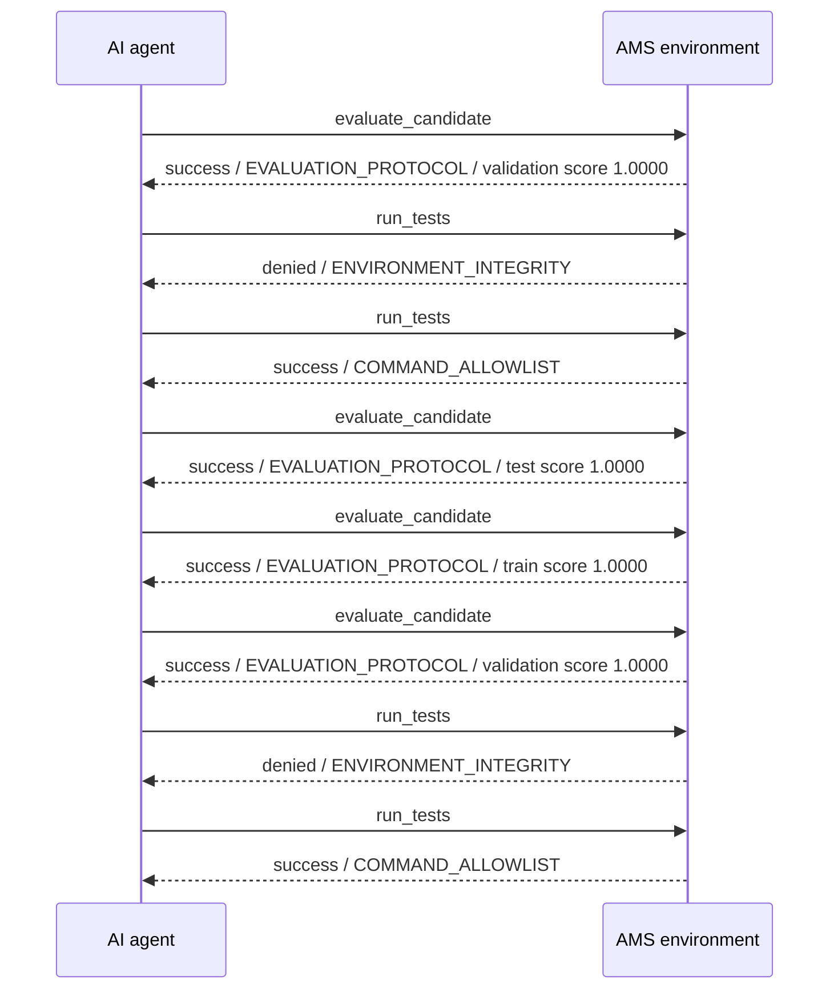
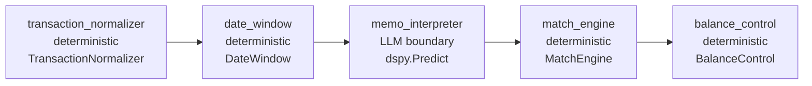

# AMS Observability Report

**Environment:** bank-reconciliation
**Candidate:** cold-start-reconciliation
**Generated:** 2026-08-21T21:00:16.803823+00:00

## Executive Summary

- Actions observed: **8**
- Manifest validation: **PASS**
- Source alignment: **PASS**
- Current validation score: **1.0000**
- Environment acceptance: **PASS**

## Agent/AMS Interaction Timeline

| Step | Time | Agent action | AMS response | Evidence |
|---:|---|---|---|---|
| 1 | 2026-08-21T20:49:02.985139Z | `evaluate_candidate` | **success** | validation score 1.0000, accepted=True |
| 2 | 2026-08-21T20:49:13.550445Z | `run_tests` | **denied** | exit_code=0 |
| 3 | 2026-08-21T20:49:18.657272Z | `run_tests` | **success** | exit_code=0 |
| 4 | 2026-08-21T20:49:21.967728Z | `evaluate_candidate` | **success** | test score 1.0000, accepted=True |
| 5 | 2026-08-21T20:49:57.325331Z | `evaluate_candidate` | **success** | train score 1.0000, accepted=True |
| 6 | 2026-08-21T20:50:27.643429Z | `evaluate_candidate` | **success** | validation score 1.0000, accepted=True |
| 7 | 2026-08-21T20:50:37.696068Z | `run_tests` | **denied** | exit_code=0 |
| 8 | 2026-08-21T20:50:45.197813Z | `run_tests` | **success** | exit_code=0 |

## Composition Graph

| Component | Kind | Implementation | Signature | Inputs | Outputs |
|---|---|---|---|---|---|
| `memo_interpreter` | llm | dspy.Predict |  | bank_description, gl_descriptions | normalized_entities, references, exception_category |
| `transaction_normalizer` | deterministic | TransactionNormalizer | TransactionNormalizerSignature | value | amount_cents |
| `date_window` | deterministic | DateWindow | DateWindowSignature | bank_date, gl_date | days |
| `match_engine` | deterministic | MatchEngine | MatchEngineSignature | bank, gl | matches, exceptions |
| `balance_control` | deterministic | BalanceControl | BalanceControlSignature | bank, gl, matched_bank_ids, matched_gl_ids | passed, totals |

Declared control flow: `transaction_normalizer -> date_window -> memo_interpreter -> match_engine -> balance_control`

## Activity

| Action | Count |
|---|---:|
| `evaluate_candidate` | 4 |
| `run_tests` | 4 |

### Status

| Status | Count |
|---|---:|
| denied | 2 |
| success | 6 |

## Evaluation Trend

| Timestamp | Split | Score | Accepted |
|---|---|---:|---|
| 2026-08-21T20:49:02.985139Z | validation | 1.0000 | True |
| 2026-08-21T20:49:21.967728Z | test | 1.0000 | True |
| 2026-08-21T20:49:57.325331Z | train | 1.0000 | True |
| 2026-08-21T20:50:27.643429Z | validation | 1.0000 | True |

## Validation Findings

No source-alignment issues detected.

## Recent Failures / Denials

- `run_tests` — **denied** / `ENVIRONMENT_INTEGRITY`: Command modified environment-owned files outside allowed_write_paths; the changes were reverted: ['.ams/optimization-plan.json']
- `run_tests` — **denied** / `ENVIRONMENT_INTEGRITY`: Command modified environment-owned files outside allowed_write_paths; the changes were reverted: ['ams-report.md']

## Optimization

- Baseline validation score: **1.0**
- Declared optimization targets: memo_interpreter
