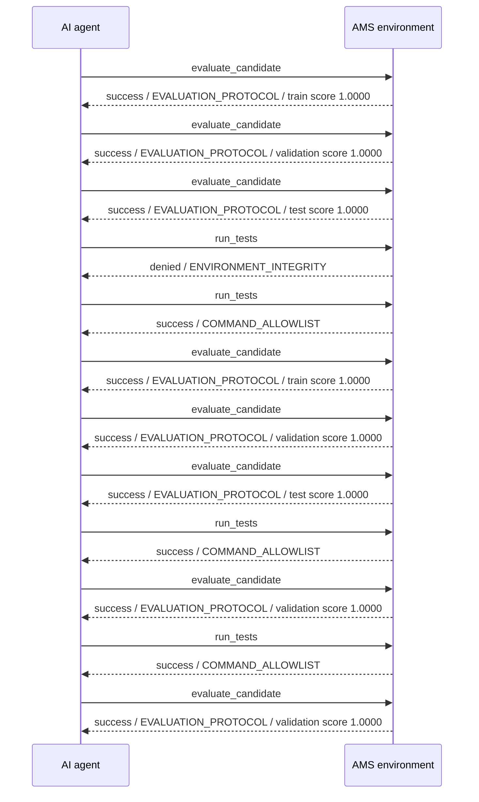
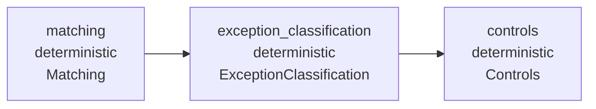

# AMS Observability Report

**Environment:** bank-reconciliation
**Candidate:** monthly-bank-reconciliation
**Generated:** 2026-08-21T21:00:16.835528+00:00

## Executive Summary

- Actions observed: **36**
- Manifest validation: **PASS**
- Source alignment: **PASS**
- Current validation score: **1.0000**
- Environment acceptance: **PASS**

## Agent/AMS Interaction Timeline

| Step | Time | Agent action | AMS response | Evidence |
|---:|---|---|---|---|
| 25 | 2026-08-21T19:58:46.958514Z | `evaluate_candidate` | **success** | train score 1.0000, accepted=True |
| 26 | 2026-08-21T19:58:47.059293Z | `evaluate_candidate` | **success** | validation score 1.0000, accepted=True |
| 27 | 2026-08-21T19:58:56.965071Z | `evaluate_candidate` | **success** | test score 1.0000, accepted=True |
| 28 | 2026-08-21T20:28:33.581927Z | `run_tests` | **denied** | exit_code=0 |
| 29 | 2026-08-21T20:29:02.948915Z | `run_tests` | **success** | exit_code=0 |
| 30 | 2026-08-21T20:29:03.039852Z | `evaluate_candidate` | **success** | train score 1.0000, accepted=True |
| 31 | 2026-08-21T20:29:03.123704Z | `evaluate_candidate` | **success** | validation score 1.0000, accepted=True |
| 32 | 2026-08-21T20:29:03.210225Z | `evaluate_candidate` | **success** | test score 1.0000, accepted=True |
| 33 | 2026-08-21T20:35:26.695211Z | `run_tests` | **success** | exit_code=0 |
| 34 | 2026-08-21T20:35:26.786298Z | `evaluate_candidate` | **success** | validation score 1.0000, accepted=True |
| 35 | 2026-08-21T20:37:55.366347Z | `run_tests` | **success** | exit_code=0 |
| 36 | 2026-08-21T20:37:55.455689Z | `evaluate_candidate` | **success** | validation score 1.0000, accepted=True |

## Composition Graph

| Component | Kind | Implementation | Signature | Inputs | Outputs |
|---|---|---|---|---|---|
| `matching` | deterministic | Matching | MatchingSignature | bank, gl | matches, unmatched_bank, unmatched_gl |
| `exception_classification` | deterministic | ExceptionClassification | ExceptionClassificationSignature | unmatched_bank, unmatched_gl, all_bank, all_gl | exceptions |
| `controls` | deterministic | Controls | ControlsSignature | bank_raw, gl_raw, result, unmatched_bank, unmatched_gl | controls, balance_proof |

Declared control flow: `matching -> exception_classification -> controls`

## Activity

| Action | Count |
|---|---:|
| `evaluate_candidate` | 10 |
| `run_tests` | 10 |
| `write_file` | 16 |

### Status

| Status | Count |
|---|---:|
| denied | 1 |
| success | 35 |

## Evaluation Trend

| Timestamp | Split | Score | Accepted |
|---|---|---:|---|
| 2026-08-21T19:56:48.548442Z | train | 1.0000 | True |
| 2026-08-21T19:56:48.651584Z | validation | 1.0000 | True |
| 2026-08-21T19:58:46.958514Z | train | 1.0000 | True |
| 2026-08-21T19:58:47.059293Z | validation | 1.0000 | True |
| 2026-08-21T19:58:56.965071Z | test | 1.0000 | True |
| 2026-08-21T20:29:03.039852Z | train | 1.0000 | True |
| 2026-08-21T20:29:03.123704Z | validation | 1.0000 | True |
| 2026-08-21T20:29:03.210225Z | test | 1.0000 | True |
| 2026-08-21T20:35:26.786298Z | validation | 1.0000 | True |
| 2026-08-21T20:37:55.455689Z | validation | 1.0000 | True |

## Validation Findings

No source-alignment issues detected.

## Recent Failures / Denials

- `run_tests` — **denied** / `ENVIRONMENT_INTEGRITY`: Command modified environment-owned files outside allowed_write_paths; the changes were reverted: ['.ams/history.jsonl']

## Optimization

No optimization plan has been issued.
